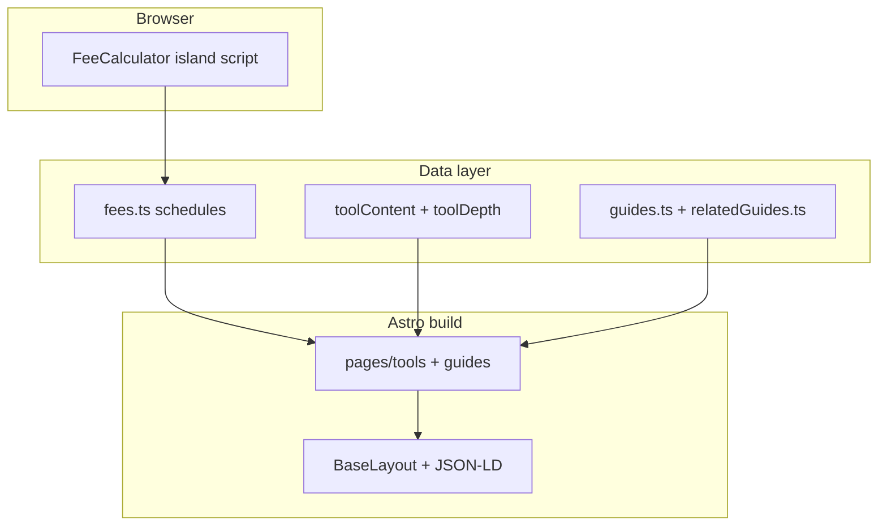

# AGENTS.md — Payment fee calculators site

## Overview

Static Astro site (`src/`) with client-side fee math (`src/lib/fees/`), versioned schedules (`src/data/fees.ts`), 12 processor tools + comparison, guides, and SEO/AdSense infrastructure.

## Architecture

## Commands

| Command | Purpose |
|---------|---------|
| `npm run dev` | Local dev server |
| `npm run build` | Static `dist/` |
| `npm test` | Vitest fee formulas + worker ext guard |
| `npm run audit` | SEO, AdSense, JS budget, links, structured data |
| `npm run lhci` | Lighthouse CI mobile budgets |
| `npm run check` | build + test + audit |

## Config (single owner file)

`src/config/site.ts` — domain via **`PUBLIC_SITE_URL`** (workers.dev fallback), brand, AdSense, GA4, verification tokens, IndexNow key.

**All** canonicals, sitemap, robots.txt, llms.txt, OG, JSON-LD, and IndexNow must use `siteConfig.siteUrl`. See `docs/SEO-GUARDRAILS.md` for custom-domain cutover (env var → Workers custom domain → 301 workers.dev → Search Console / GA).

## Add a new tool page

1. Add `ProcessorSchedule` in `src/data/fees.ts` (rates + `sourceUrl` + `lastVerified`).
2. Add keyword meta in `src/lib/tools.ts` (`keywordMap` entry).
3. Add `toolContent` + `toolDepth` entries in `src/data/`.
4. Add topical guides in `src/data/relatedGuides.ts` (`toolGuideMap`).
5. Page auto-generates via `src/pages/tools/[slug].astro` from `processors` list.
6. Add to `comparisonOrder` if needed; link from relevant hub in `hubCategories`.
7. Add embed route automatically via `src/pages/embed/[slug].astro` (canonical → tool; noindex).
8. Update `docs/KEYWORD-MAP.md`, `llms.txt` (auto from data), run `npm test` and `npm run audit`.
9. Follow `.cursor/skills/add-new-tool/SKILL.md`.

## Add / expand a guide

1. Add or expand entry in `src/data/guides.ts` (~1000+ words; CI requires ≥800).
2. Include `answerFirst`, `takeaways` (3–5 bullets with numbers), worked example, `feeTable`, FAQ (FAQPage), `sources` with as-of dates, `relatedTools` / `relatedGuides` / hubs.
3. Reuse fee numbers from `src/data/fees.ts` only.
4. Wire tools via `relatedGuides.ts`; update KEYWORD-MAP.
5. Follow `.cursor/skills/write-seo-article/SKILL.md` and `docs/SEO-GUARDRAILS.md`.

## Content / SEO rules

- Governing docs: `docs/SEO-PLAYBOOK.md`, **`docs/SEO-GUARDRAILS.md`**, `.cursor/rules/seo-guardrails.mdc`, **`.cursor/rules/seo-pages.mdc`**
- **Research first** for any new page (keyword, intent, SERP format, cannibalization) — see seo-pages checklist
- One primary keyword per URL: `docs/KEYWORD-MAP.md`
- Tool pages: calculator above fold, 600–1200 words, formula, worked example, FAQ, sources, **Learn more** guides
- Direct-answer intro 40–60 words with a worked number; guides need a takeaways box before the byline
- Hubs/home: tool cards directly under the lead (above the fold on mobile)
- Disclaimer is not an FAQ item; footer labels must not be heading elements
- Visible breadcrumbs + BreadcrumbList on hubs, guides, about, contact, methodology, privacy, terms
- Worker `FILE_EXT` must allow `.webmanifest` (11+ char extensions)
- Fee freshness: `docs/FEE-UPDATE.md` + content-refresh skill
- Local gate: `npm run audit:pages` (also part of `npm run audit` and `.github/workflows/page-audit.yml`)

## Per-page checklist (required)

Before shipping a new or reworked page, confirm:

1. Keyword + intent researched; no near-duplicate URL
2. One H1; answer-first block with a number; tool ≤450px on mobile
3. Title 30–60 / meta 70–155 / absolute canonical / viewport
4. Valid JSON-LD (BreadcrumbList; WebApplication or Article; FAQPage iff visible FAQ)
5. Sources from `fees.ts` or primary URLs; byline after the answer
6. In sitemap; `npm run build && npm test && npm run audit` green

## AdSense

- `docs/ADSENSE.md`, `npm run audit:adsense`
- Financial disclaimer on tools: `src/components/Disclaimer.astro` (note, not FAQ)

## Subagents (`.cursor/agents/`)

| Agent | Role |
|-------|------|
| `seo-auditor` | On-page + technical SEO after build |
| `content-writer` | Guides and tool prose |
| `adsense-reviewer` | Policy + page readiness |
| `performance-auditor` | Lighthouse / CWV |
| `link-builder-researcher` | Outreach ideas |
| `fee-fact-checker` | Verify rates against official URLs |

## Definition of done

- All tools work forward + reverse; tests pass for every schedule
- `npm run build`, `npm test`, `npm run audit`, `npm run lhci` pass
- Docs, skills, CI, README complete; SEO guardrails green
- PR to `main` with Lighthouse scores and 360px screenshots
