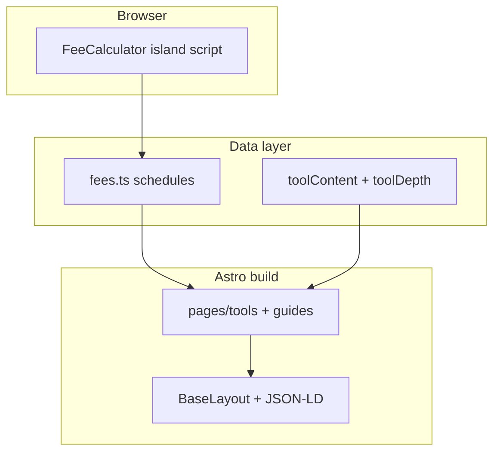

# AGENTS.md — Payment fee calculators site

## Overview

Static Astro site (`src/`) with client-side fee math (`src/lib/fees/`), versioned schedules (`src/data/fees.ts`), 12 processor tools + comparison, guides, and SEO/AdSense infrastructure.

## Architecture

## Commands

| Command | Purpose |
|---------|---------|
| `npm run dev` | Local dev server |
| `npm run build` | Static `dist/` |
| `npm test` | Vitest fee formulas |
| `npm run audit` | SEO, AdSense, JS budget, links |
| `npm run lhci` | Lighthouse CI mobile budgets |
| `npm run check` | build + test + audit |

## Config (single owner file)

`src/config/site.ts` — domain, brand, AdSense, GA4, verification tokens.

## Add a new tool page

1. Add `ProcessorSchedule` in `src/data/fees.ts` (rates + `sourceUrl` + `lastVerified`).
2. Add keyword meta in `src/lib/tools.ts` (`keywordMap` entry).
3. Add `toolContent` + `toolDepth` entries in `src/data/`.
4. Page auto-generates via `src/pages/tools/[slug].astro` from `processors` list.
5. Add to `comparisonOrder` if needed; link from relevant hub in `hubCategories`.
6. Add embed route automatically via `src/pages/embed/[slug].astro`.
7. Update `docs/KEYWORD-MAP.md`, run `npm test` and `npm run audit`.
8. Follow `.cursor/skills/add-new-tool/SKILL.md`.

## Content / SEO rules

- Governing doc: `docs/SEO-PLAYBOOK.md`
- One primary keyword per URL: `docs/KEYWORD-MAP.md`
- Tool pages: calculator above fold, 600–1200 words, formula, worked example, FAQ, sources table
- No FAQ rich result reliance (Google removed May 2026)
- Fee freshness: `docs/FEE-UPDATE.md` + content-refresh skill

## AdSense

- `docs/ADSENSE.md`, `npm run audit:adsense`
- Financial disclaimer on tools: `src/components/Disclaimer.astro`

## Subagents (`.cursor/agents/`)

| Agent | Role |
|-------|------|
| `seo-auditor` | On-page + technical SEO after build |
| `content-writer` | Guides and tool prose |
| `adsense-reviewer` | Policy + page readiness |
| `performance-auditor` | Lighthouse / CWV |
| `link-builder-researcher` | Outreach ideas |
| `fee-fact-checker` | Verify rates against official URLs |

## Definition of done

- All tools work forward + reverse; tests pass for every schedule
- `npm run build`, `npm test`, `npm run audit`, `npm run lhci` pass
- Docs, skills, CI, README complete
- PR to `main` with Lighthouse scores and 360px screenshots
