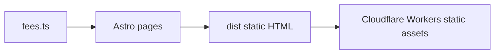

# Payment processor & creator fee calculators

Free, client-side calculators for **Stripe**, **PayPal**, **Square**, **Venmo**, **Cash App**, **Zelle**, **Patreon**, **Ko-fi**, **Buy Me a Coffee**, **Gumroad**, **Shopify Payments**, and **Wise** — plus a **comparison** page. Forward (“fee on amount”) and reverse (“charge to receive X”) on every tool.

**Stack:** Astro 5 (static) + TypeScript. No backend; amounts never leave the browser.



## Tool list

| Tool | Path |
|------|------|
| Stripe | `/tools/stripe-fee-calculator/` |
| PayPal | `/tools/paypal-fee-calculator/` |
| Square | `/tools/square-fee-calculator/` |
| Venmo | `/tools/venmo-fee-calculator/` |
| Cash App | `/tools/cash-app-fee-calculator/` |
| Zelle | `/tools/zelle-fee-calculator/` |
| Patreon | `/tools/patreon-fee-calculator/` |
| Ko-fi | `/tools/kofi-fee-calculator/` |
| Buy Me a Coffee | `/tools/buy-me-a-coffee-fee-calculator/` |
| Gumroad | `/tools/gumroad-fee-calculator/` |
| Shopify Payments | `/tools/shopify-payments-fee-calculator/` |
| Wise | `/tools/wise-transfer-fee-calculator/` |
| Compare all | `/tools/compare-payment-fees/` |

Hubs: `/payment-processors/`, `/p2p-fees/`, `/creator-fees/`. Guides: `/guides/`.

## Folder structure

```
src/
  config/site.ts      # Owner config (domain, ads, analytics)
  data/fees.ts        # Versioned fee schedules + sources
  lib/fees/           # calculate.ts + tests
  pages/tools/        # Tool + compare pages
  components/         # FeeCalculator, AdSlot, Disclaimer
docs/                 # DEPLOYMENT, SEO-GUIDE, ADSENSE, FEE-UPDATE, KEYWORD-MAP
scripts/audit/        # npm run audit
.cursor/              # Skills, rules, agents
```

## Prerequisites

- Node.js 20+
- npm 10+

## Local setup

```bash
cp .env.example .env   # optional; edit PUBLIC_* values
npm ci
npm run dev            # http://localhost:4321
```

## Scripts

| Script | Description |
|--------|-------------|
| `npm run build` | Production build → `dist/` |
| `npm test` | Unit tests (every fee formula + reverse) |
| `npm run audit` | SEO, AdSense readiness, JS budget, links |
| `npm run lhci` | Lighthouse CI (mobile, budgets in `lighthouserc.cjs`) |
| `npm run check` | build + test + audit |

## Configuration

All owner placeholders live in **`src/config/site.ts`** (overridable via `PUBLIC_*` env vars). See `.env.example`.

| Value / env | Purpose |
|-------------|---------|
| `siteUrl` (`PUBLIC_SITE_URL`) | Canonical origin (Workers Builds should set this) |
| `adsensePublisherId` | Empty = ads disabled |
| `ga4MeasurementId` (`PUBLIC_GA4_MEASUREMENT_ID`) | GA4; empty = no analytics |
| `googleSiteVerification` | Search Console |
| `indexNowKey` | Bing IndexNow (`public/<key>.txt`) |

## Adding a tool or article

See **`AGENTS.md`** and `.cursor/skills/add-new-tool/SKILL.md`.

## Testing & CI

- Vitest: `src/lib/fees/calculate.test.ts` covers all schedules.
- GitHub Actions: `.github/workflows/ci.yml` runs build, test, audit.

## Performance budgets

- Mobile Lighthouse ≥ 95 (performance, SEO, a11y, best practices)
- LCP &lt; 2.0s, CLS &lt; 0.05, TBT &lt; 150ms (see `lighthouserc.cjs`)
- Per-bundle JS ≤ 50 KB gzip (`scripts/audit/budget.mjs`)

## SEO / AI search

- `docs/SEO-GUIDE.md`, `docs/SEO-PLAYBOOK.md`, `docs/KEYWORD-MAP.md`
- `robots.txt` allows major search and AI answer bots
- Optional `public/llms.txt`

## AdSense

- `docs/ADSENSE.md` — apply after traffic + quality bar; set publisher ID to enable slots.

## Deployment

**Quick start:** `npm run build` → deploy `dist/`. Full steps: **`docs/DEPLOYMENT.md`**.

## Post-launch

Search Console sitemap, Bing IndexNow, fee refresh process: **`docs/FEE-UPDATE.md`**.

## Research & ideas

- `docs/MARKET-RESEARCH.md`, `docs/ideas/README.md` (idea #15 = this site)

## Proof (SEO, performance, AdSense)

Committed evidence generated by tools (not hand-edited scores):

```bash
npm run proof          # regenerate docs/proof (Lighthouse, screenshots)
npm run proof:verify   # CI: validate committed proof + audits
npm run check          # build, test, audit, proof:verify
```

See **[docs/proof/README.md](docs/proof/README.md)** for the index, Lighthouse summaries, structured-data validation, audits, and mobile screenshots.

## Docs index

| Doc | Topic |
|-----|--------|
| `AGENTS.md` | Agent & contributor guide |
| `docs/DEPLOYMENT.md` | Hosting |
| `docs/SEO-GUIDE.md` | Launch & 90-day SEO |
| `docs/ADSENSE.md` | Monetization |
| `docs/FEE-UPDATE.md` | Rate maintenance |
| `docs/proof/README.md` | SEO/perf/AdSense proof artifacts |
| `PROGRESS.md` | Live build progress |

## Troubleshooting

| Problem | Fix |
|---------|-----|
| Audit word count fail | Expand `toolContent` / `toolDepth` |
| Wrong canonical | Set `PUBLIC_SITE_URL` |
| Lighthouse fail | Check compare page JS; run `npm run lhci` locally |

## License

Content and code in this repository are provided for the site owner’s use. Payment brand names are trademarks of their respective owners.
